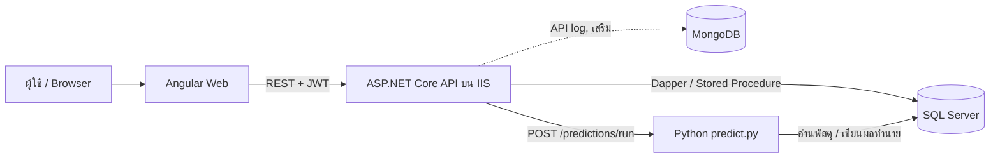

# THP Parcel Data Service Hub — ระบบบริการข้อมูลพัสดุ `DEMO`

> **ข้อมูลจำลองเพื่อการนำเสนอ (Simulated data)**
> โปรเจกต์ส่วนตัวเพื่อประกอบการสัมภาษณ์งาน **ไม่ใช่ระบบทางการของ บริษัท ไปรษณีย์ไทย จำกัด**
> ไม่ใช้ข้อมูลจริง โลโก้ ภาพ หรือเนื้อหาของไปรษณีย์ไทย

ระบบตัวอย่างสำหรับเจ้าหน้าที่ ใช้ **ติดตามพัสดุ ดูสถิติการให้บริการ และดูพัสดุที่มีความเสี่ยงล่าช้า**
พัฒนาครบทุกชั้น: **SQL Server → ASP.NET Core REST API → Angular**
และใช้ **Python** ทำนายความเสี่ยงพัสดุล่าช้า

<!-- TODO: รอจนกว่าจะมีภาพ demo image -->


---

## สารบัญ

- [สถาปัตยกรรมระบบ](#สถาปัตยกรรมระบบ)
- [ความสามารถของระบบ](#ความสามารถของระบบ)
- [เทคโนโลยีที่ใช้](#เทคโนโลยีที่ใช้)
- [ผลการวัด](#ผลการวัด)
- [วิธีติดตั้งและรัน](#วิธีติดตั้งและรัน)
- [API](#api)
- [โครงสร้างโปรเจกต์](#โครงสร้างโปรเจกต์)
- [เหตุผลการออกแบบ](#เหตุผลการออกแบบ)
- [ข้อจำกัดและแผนต่อยอด](#ข้อจำกัดและแผนต่อยอด)
- [English summary](#english-summary)

---

## สถาปัตยกรรมระบบ



- หน้าเว็บ **ไม่ต่อฐานข้อมูลตรง** ทุกข้อมูลผ่าน API
- API เรียก **Stored Procedure** ผ่าน **Dapper** ไม่มี SQL ปนในโค้ด C#
- ความเสี่ยงล่าช้า **คำนวณล่วงหน้า** ด้วย `predict.py` แล้วเก็บในตาราง `DelayPrediction`
  หน้าเว็บอ่านผลจากตาราง ไม่รันโมเดลทุกครั้งที่เปิดหน้า

ER Diagram: [docs/er-diagram.md](docs/er-diagram.md)

---

## ความสามารถของระบบ

<!-- เฉพาะสิ่งที่ทำงานได้จริงใน Demo เท่านั้น -->

| ความสามารถ | สถานะ |
|---|---|
| เข้าสู่ระบบด้วย JWT (บทบาท: เจ้าหน้าที่ / ผู้ดูแลข้อมูล / ผู้ดูแลระบบ) | ⬜ |
| ค้นหาพัสดุได้ครั้งละสูงสุด 10 หมายเลข (คั่นด้วย Comma) | ⬜ |
| ไทม์ไลน์สถานะพัสดุ (รับฝาก → คัดแยก → ขนส่ง → ถึงที่ทำการ → นำจ่าย) | ⬜ |
| Dashboard จำนวนพัสดุรายเดือนและอัตราส่งตรงเวลา | ⬜ |
| อันดับสาขาที่ส่งล่าช้า | ⬜ |
| คาดการณ์ความเสี่ยงล่าช้า (Low / Medium / High) | ⬜ |
| ปุ่ม "คำนวณความเสี่ยงใหม่" (สั่งรัน `predict.py`) | ⬜ |
| เอกสาร API ด้วย Swagger | ⬜ |
| บันทึก API log ลง MongoDB | ⬜ เสริม |
| Deploy บน IIS | ⬜ |

---

## เทคโนโลยีที่ใช้

| ส่วน | เทคโนโลยี |
|---|---|
| ฐานข้อมูล | SQL Server 2025, Stored Procedure, Index |
| Back End | ASP.NET Core (.NET 10) Web API, Dapper, JWT, Swagger |
| Front End | Angular 21 |
| Data Science | Python 3.12, pandas, scikit-learn, Faker |
| Web Server | IIS |
| เครื่องมือ | Visual Studio 2026 (API), VS Code (Angular, Python), SSMS |

---

## ผลการวัด

วัดบนข้อมูลจำลอง **[XX] รายการ** ในเครื่องของผู้พัฒนา

### ผลของ Index ต่อความเร็ว Query

| Query | ก่อนทำ Index | หลังทำ Index | เร็วขึ้น |
|---|---|---|---|
| `sp_GetParcelByTrackingNo` | [XX] logical reads / [XX] ms | [XX] logical reads / [XX] ms | [XX] เท่า |
| `sp_GetMonthlySummary` | [XX] / [XX] ms | [XX] / [XX] ms | [XX] เท่า |
| `sp_GetBranchDelays` | [XX] / [XX] ms | [XX] / [XX] ms | [XX] เท่า |

วิธีวัด: `SET STATISTICS IO, TIME ON` เฉลี่ย [XX] ครั้ง สคริปต์อยู่ใน `database/perf/`

### โมเดลทำนายความเสี่ยงล่าช้า

| โมเดล | Accuracy | Precision | Recall |
|---|---|---|---|
| Logistic Regression | [XX] | [XX] | [XX] |
| Random Forest | [XX] | [XX] | [XX] |

ปัจจัยที่ใช้: ระยะทาง, น้ำหนัก, ช่วงเวลารับฝาก, สาขาต้นทาง · `random_state = [XX]` (รันซ้ำได้ผลเดิม)
รายละเอียด: [ml/train_model.ipynb](ml/train_model.ipynb)

---

## วิธีติดตั้งและรัน

### สิ่งที่ต้องมี

| เครื่องมือ | เวอร์ชันที่ใช้พัฒนา | ตรวจสอบด้วย |
|---|---|---|
| SQL Server (Express) | 2025 (17.0) | `SELECT @@VERSION` |
| SSMS | 22 | Help → About |
| .NET SDK | 10.0 | `dotnet --version` |
| Node.js | 22 LTS | `node --version` |
| Angular CLI | 21 | `ng version` |
| Python | 3.12 | `python --version` |

### 1. ฐานข้อมูล

รันใน SSMS ตามลำดับ:

```text
database/01_schema.sql
database/03_stored_procedures.sql
```

### 2. สร้างข้อมูลจำลอง

สร้าง virtual environment ด้วย Python 3.12 ที่โฟลเดอร์หลักของโปรเจกต์ (ทำครั้งแรกครั้งเดียว)

```bash
py -3.12 -m venv thp-parcel-hub
thp-parcel-hub\Scripts\activate
```

```bash
cd data-generator
pip install -r requirements.txt
python generate_data.py
```

จากนั้นรัน `database/02_indexes.sql`

### 3. API

```bash
cd api
# คัดลอกไฟล์ตั้งค่าตัวอย่าง แล้วใส่ Connection String และ JWT Key ของตัวเอง
copy appsettings.Example.json appsettings.Development.json
dotnet run
```

Swagger: `https://localhost:[port]/swagger`

### 4. หน้าเว็บ

```bash
cd web
npm install
ng serve
```

เปิด `http://localhost:4200`

### บัญชีทดลอง (จำลอง)

| บทบาท | Username | Password |
|---|---|---|
| เจ้าหน้าที่ | [XX] | [XX] |
| ผู้ดูแลข้อมูล | [XX] | [XX] |
| ผู้ดูแลระบบ | [XX] | [XX] |

---

## API

Base URL: `/api/v1`

| Method | Path | คำอธิบาย | สิทธิ์ |
|---|---|---|---|
| POST | `/auth/login` | รับ JWT | ทุกคน |
| GET | `/parcels/{no}` | ข้อมูลและสถานะพัสดุ | เจ้าหน้าที่ |
| GET | `/parcels/{no}/events` | ไทม์ไลน์เหตุการณ์ | เจ้าหน้าที่ |
| GET | `/stats/summary?month=` | สถิติสรุปรายเดือน | ผู้ดูแลข้อมูล |
| GET | `/branches/delays` | อัตราล่าช้ารายสาขา | ผู้ดูแลข้อมูล |
| GET | `/predictions/{no}` | ความเสี่ยงล่าช้าของพัสดุ | เจ้าหน้าที่ |
| POST | `/predictions/run` | คำนวณความเสี่ยงใหม่ | ผู้ดูแลข้อมูล |
| GET | `/logs` | บันทึกการเรียก API | ผู้ดูแลระบบ |

รหัสตอบกลับ: `200` สำเร็จ · `401` ยังไม่เข้าสู่ระบบ · `404` ไม่พบพัสดุ · `429` เรียกถี่เกินกำหนด

---

## โครงสร้างโปรเจกต์

```text
parcel-data-service-hub/
├─ database/        Schema, Index, Stored Procedure, สคริปต์วัดเวลา
├─ data-generator/  สคริปต์ Faker สร้างข้อมูลจำลอง
├─ api/             ASP.NET Core Web API (Visual Studio Solution)
├─ web/             Angular Front End
├─ ml/              Notebook ฝึกโมเดล และ predict.py
└─ docs/            ER Diagram, รูปภาพ
```

---

## เหตุผลการออกแบบ

- **ใช้ Dapper + Stored Procedure แทน EF Core:** เห็น SQL ชัดเจน ปรับจูนประสิทธิภาพได้ตรงจุด
  และเหมาะกับการทำงานร่วมกับทีมฐานข้อมูล
- **เก็บ `CurrentStatus` ไว้ในตาราง `Parcel` (Denormalize โดยตั้งใจ):** หน้าติดตามพัสดุอ่านสถานะล่าสุดได้ทันที
  ไม่ต้องค้นประวัติเหตุการณ์ทุกครั้ง ข้อแลกเปลี่ยนคือต้องอัปเดตพร้อมกับการเพิ่มเหตุการณ์ใหม่
- **เก็บผลทำนายไว้ในตาราง ไม่คำนวณสด:** หน้าเว็บโหลดเร็ว และผลคงที่ตรวจสอบย้อนหลังได้
  ในระบบจริงจะตั้งเวลาฝึกโมเดลใหม่เป็นรอบ ผ่านผู้ดูแลที่มีสิทธิ์
- **รองรับการย้ายไป Oracle:** ใช้รหัสสถานะแบบข้อความธรรมดา และหลีกเลี่ยงชนิดข้อมูลเฉพาะของ SQL Server
  ส่วน Stored Procedure ต้องเขียนใหม่เป็น PL/SQL
- **ข้อมูลส่วนบุคคล (PDPA):** ชื่อและเบอร์โทรเป็นข้อมูลจำลองทั้งหมด และ API ส่งเบอร์โทรแบบปิดบังบางส่วน

---

## ข้อจำกัดและแผนต่อยอด

- ใช้ข้อมูลจำลองเท่านั้น การกระจายของข้อมูลไม่สะท้อนการดำเนินงานจริง
- ยังไม่มี CI แผนต่อไปคือ Build และ Test อัตโนมัติทุกครั้งที่เปิด Pull Request
- [XX]

---

## English summary

Parcel Data Service Hub is a demo system built with **simulated data** for a job interview portfolio.
It is not an official Thailand Post system. Staff can track parcels, view monthly service statistics
and see which parcels are at risk of late delivery. The stack is SQL Server with stored procedures,
an ASP.NET Core REST API with JWT and Swagger, an Angular front end, and a Python (scikit-learn) model
whose predictions are stored in the database. The system is deployed on IIS.

---

## ผู้พัฒนา

[ชื่อ–นามสกุล] · [อีเมล] · [GitHub]

จัดทำเพื่อประกอบการสัมภาษณ์งาน 1 ธันวาคม 2569