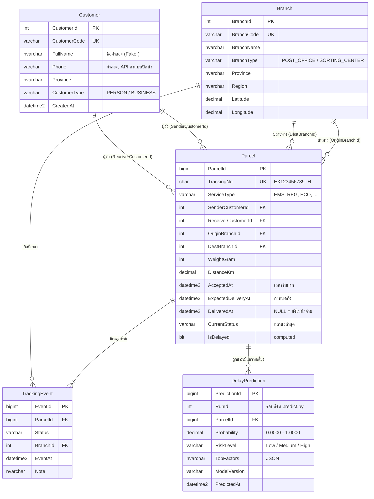

# ER Diagram — Parcel Data Service Hub (ข้อมูลจำลองเพื่อการนำเสนอ)

สถานะ (CurrentStatus / Status):

| รหัส | ความหมาย | ลำดับ |
|---|---|---|
| ACCEPTED | รับฝาก | 1 |
| SORTING | คัดแยก | 2 |
| IN_TRANSIT | อยู่ระหว่างขนส่ง | 3 |
| ARRIVED | ถึงที่ทำการ | 4 |
| DELIVERED | นำจ่าย | 5 |
